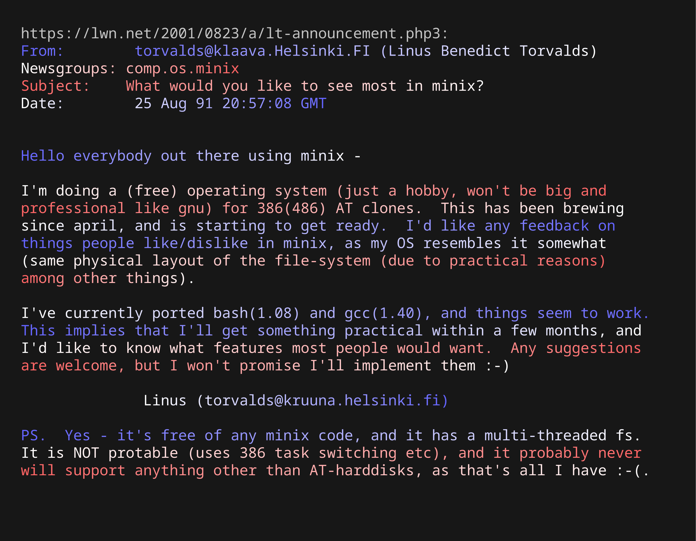
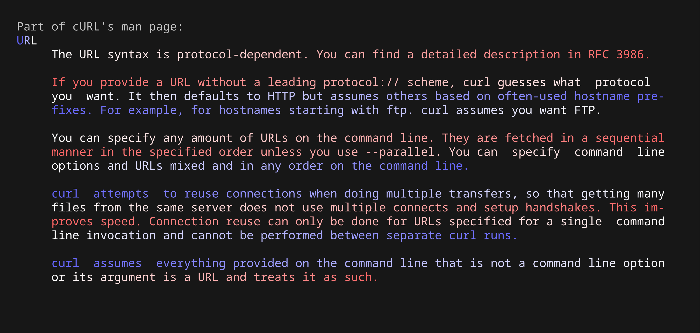

> stria (/_ˈstraɪ.ə_/)
>
>   a thin line or groove

Applies a color gradient along lines of text, like [WaspLine](https://github.com/corollari/waspline-reader?tab=readme-ov-file) and [BeeLine](https://www.beelinereader.com/)

Examples, rendered to image with [freeze](https://github.com/charmbracelet/freeze):

